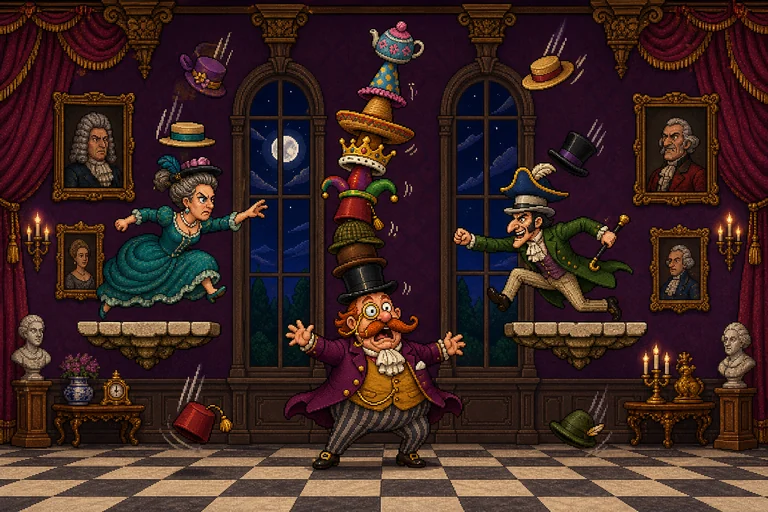

# Quimbleshaw

Quimbleshaw: the hat-stacking meme game at quimbleshaw.meme

**[Play Quimbleshaw at quimbleshaw.meme](https://quimbleshaw.meme/)**. It is free, runs in the browser and needs no account.

[](https://quimbleshaw.meme/)

Quimbleshaw is a pixel-art hat-stacking game. Hats fall from the ballroom ceiling. You catch them, balance them in a wobbling tower and knock the hats off your rivals. Whoever has the most hats when the bell rings, three minutes later, wins.

This repository is the whole site: the game, the page it sits on and the design notes.

## What does quimbleshaw mean?

Quimbleshaw is an invented word. It had no meaning and no search results until 20 November 2026, when it was announced as the keyword for the [Advise SEO contest](https://advise.so/seo-contest-page/). This project gave it a meaning:

1. **noun.** Lord Quimbleshaw: a pompous, portly English lord with a magnificent moustache, who believes the height of a hat tower is the true measure of its owner.
2. **noun.** The hat-stacking game named after him, played in his ballroom and largely at his expense.
3. **verb.** To quimbleshaw someone is to knock the hats off their tower. To be quimbleshawed is to lose a tower you were visibly proud of, usually seconds before the bell.

## How a round of Quimbleshaw plays

- **Catch.** Walk into a falling hat and it lands on your head.
- **Balance.** Every hat makes the tower taller and wobblier. Turn too sharply, land too hard or run under the chandelier and the hats spill across the floor.
- **Steal.** Land on a rival's tower to knock their top hats loose, then catch them first.
- **The bell.** A round lasts three minutes. Only the hats on your head count.

You play against the house: Lord Quimbleshaw, the Dowager Duchess and the Baron. All three are bots and are labelled as bots.

**One ballroom a day.** Each day has one numbered ballroom, and the same hats fall in the same places for every player.

**Special hats.** About one falling hat in fourteen gives a power for a few seconds instead of joining the tower, and each one can go wrong:

| Hat | What it does | The catch |
|-----|--------------|-----------|
| Magnet hat | Hats near you slide your way for eight seconds | So do lit kegs |
| Iron helm | Nothing can shake or knock your tower for eight seconds | You run slowly |
| Propeller cap | You jump far higher for eight seconds | Let go of jump at the top and you land hard enough to lose hats |
| Lit keg | Goes off four seconds after you catch it; rivals close to you on your level lose half a tower | You lose a quarter of yours |

**Ranks and feathers.** First place wins two feathers and second wins one. Third loses one and last loses two, as does finishing with no hats at all. Five feathers lift you a rank, and the house plays harder at each one: Commoner, Squire, Knight, Baron, Earl, Duke and, at the top, Quimbleshaw. Lose a feather you do not have and you go down a rank, so playing for longer does not raise it.

**Controls.** Move with the arrow keys or A and D. Jump with up, W or space. Press down or S to drop through a ledge. P pauses. On a phone, buttons appear under the picture.

Every round ends with a picture of the four players and their towers, which you can save, copy or share. It is drawn in your browser and is not uploaded. Your name, rank and best scores are kept on your device and are not sent anywhere.

## How it is built

Plain HTML, CSS and JavaScript modules. There is no framework, no build step and no dependency to install: `public/` is served as it is.

| File | What it does |
|------|--------------|
| `public/index.html` | The page: the game frame, the definition, the rules, the FAQ and the structured data |
| `public/js/sim.js` | The rules. A fixed 60-steps-a-second simulation with seeded random numbers and no DOM, so the same seed and the same key presses give the same round. Hat spawns draw from their own random stream, which is why a day's hat fall is the same whatever the players do |
| `public/js/game.js` | Input, the round loop, the scoreboard, the rank ladder, results and saved data |
| `public/js/art.js` | Every sprite, as a small map of letters turned into a canvas. No image files are loaded for the game |
| `public/js/room.js` | The ballroom backdrop |
| `public/js/render.js` | Draws a round onto a 350 by 196 canvas |
| `public/js/card.js` | The 1200 by 630 result picture |
| `public/_headers` | Response headers, including the content security policy |
| `wrangler.jsonc` | Hosting: Cloudflare Workers static assets |
| `DESIGN.md` | Colours, type and the rules for how things look |
| `checks/` | Bot-only rounds of the simulation and a browser check. The top of each file says how to run it |
| `todo/PLANS.md` | The plan, the decisions and the check results |

## Run it locally

```bash
python3 -m http.server 8791 --bind 127.0.0.1 --directory public
```

Then open `http://127.0.0.1:8791/`. To test with the production response headers as well, run `npx wrangler@4 dev` from the repository root. If your wrangler is older than the `compatibility_date` in `wrangler.jsonc`, add `--compatibility-date` with a date it supports.

## Credits and licence

- Copyright 2026 Marcus Quinn. The code and the art are released under the [MIT License](LICENSE).
- The game sprites are drawn in code. The title pictures were made with an image model for this project.
- The display font, [Press Start 2P](public/assets/fonts/press-start-2p-LICENSE.txt), is not ours and keeps its own licence, the SIL Open Font License 1.1.

## Built with aidevops

This project was created and is maintained with
[aidevops.sh](https://aidevops.sh).

[View marcusquinn on GitHub](https://github.com/marcusquinn) ·
[aidevops repository](https://github.com/marcusquinn/aidevops)
